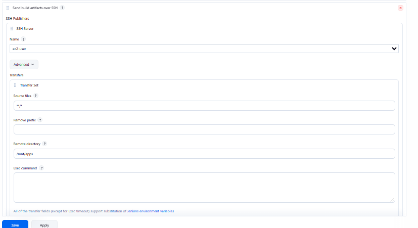
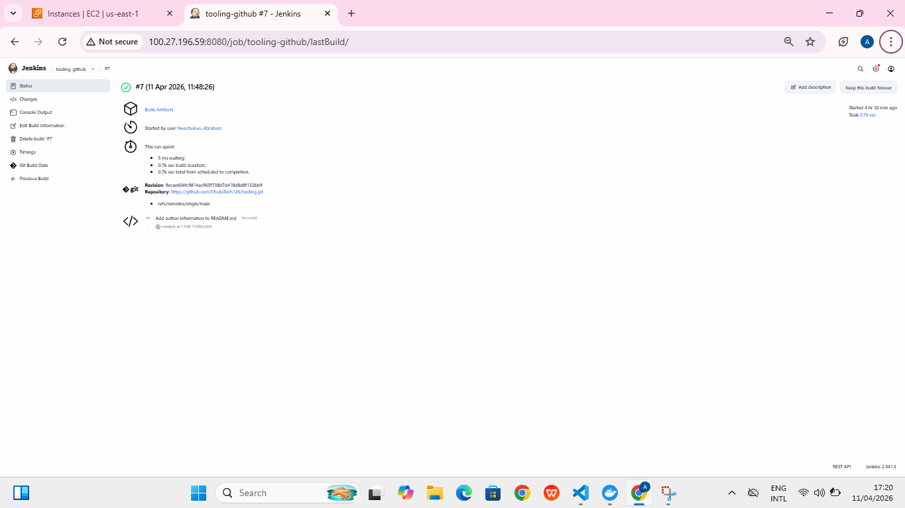

# Tooling Website deployment automation with Continuous Integration: Introduction to Jenkins

---
STEP: Install Jenkins server
Create an AWS EC2 server based on Ubuntu Server 20.04 LTS and name it “Jenkins”
---

---
Install JDK (since Jenkins is a Java-based application)
---
```bash
sudo apt update
sudo apt install default-jdk-headless
```


---
Install Jenkins
---
```bash
wget -q -O - https://pkg.jenkins.io/debian-stable/jenkins.io.key | sudo apt-key add -
sudo sh -c 'echo deb https://pkg.jenkins.io/debian-stable binary/ > \
    /etc/apt/sources.list.d/jenkins.list'
sudo apt update
sudo apt-get install jenkins
```

Make sure Jenkins is up and running

---
```bash
sudo systemctl status jenkins
```

---
---
By default Jenkins server uses TCP port 8080 – open it by creating a new Inbound Rule in your EC2 Security Group
---
Perform initial Jenkins setup.
From your browser access http://

***Jenkins-Server-Public-IP-Address-or-Public-DNS-Name:8080***

You will be prompted to provide a default admin password

---
Retrieve it from your server:
---
```bash
sudo cat /var/lib/jenkins/secrets/initialAdminPassword
```
Then you will be asked which plugings to install – choose suggested plugins.


Once plugins installation is done – create an admin user and you will get your Jenkins server address.

The installation is completed!

Step 2 – Configure Jenkins to retrieve source codes from GitHub using Webhooks
In this part, you will learn how to configure a simple Jenkins job/project (these two terms can be used interchangeably). This job will will be triggered by GitHub webhooks and will execute a ‘build’ task to retrieve codes from GitHub and store it locally on Jenkins server.

Enable webhooks in your GitHub repository settings
Go to Jenkins web console, click “New Item” and create a “Freestyle project”


To connect your GitHub repository, you will need to provide its URL, you can copy from the repository itself 

Save
the configuration and let us try to run the build. For now we can only do it manually. Click “Build Now” button, if you have configured everything correctly, the build will be successfull and you will see it under

Click “Configure” your job/project and add these two configurations
Configure triggering the job from GitHub webhook:


Configure “Post-build Actions” to archive all the files – files resulted from a build are called “artifacts”.

go ahead and make some change in any file in your GitHub repository (e.g. README.MD file) and push the changes to the master branch.

You will see that a new build has been launched automatically (by webhook) and you can see its results – artifacts, saved on Jenkins server.

  An automated Jenkins job has been configured that receives files from GitHub by webhook trigger (this method is considered as ‘push’ because the changes are being ‘pushed’ and files transfer is initiated by GitHub). There are also other methods: trigger one job (downstreadm) from another (upstream), poll GitHub periodically and others.

By default, the artifacts are stored on Jenkins server locally

```bash
ls /var/lib/jenkins/jobs/tooling_github/builds/<build_number>/archive/
```


Artifacts saved locally on Jenkins server, the next step is to copy them to our NFS server to /mnt/apps directory.

Jenkins is a highly extendable application and there are 1400+ plugins available. We will need a plugin that is called “Publish Over SSH”.

Install “Publish Over SSH” plugin.
On main dashboard select “Manage Jenkins” and choose “Manage Plugins” menu item.

On “Available” tab search for “Publish Over SSH” plugin and install it


Configure the job/project to copy artifacts over to NFS server.
On main dashboard select “Manage Jenkins” and choose “Configure System” menu item.

Scroll down to Publish over SSH plugin configuration section and configure it to be able to connect to your NFS server:

Provide a private key (content of .pem file that you use to connect to NFS server via SSH/Putty)
Arbitrary name
Hostname – can be private IP address of your NFS server
Username – ec2-user (since NFS server is based on EC2 with RHEL 8)
Remote directory – /mnt/apps since our Web Servers use it as a mointing point to retrieve files from the NFS server
Test the configuration and make sure the connection returns Success. Remember, that TCP port 22 on NFS server must be open to receive SSH connections.


Save the configuration, open your Jenkins job/project configuration page and add another one “Post-build Action”



***edit README.md***

***confirm it in the NFS server after a successful build*** 
